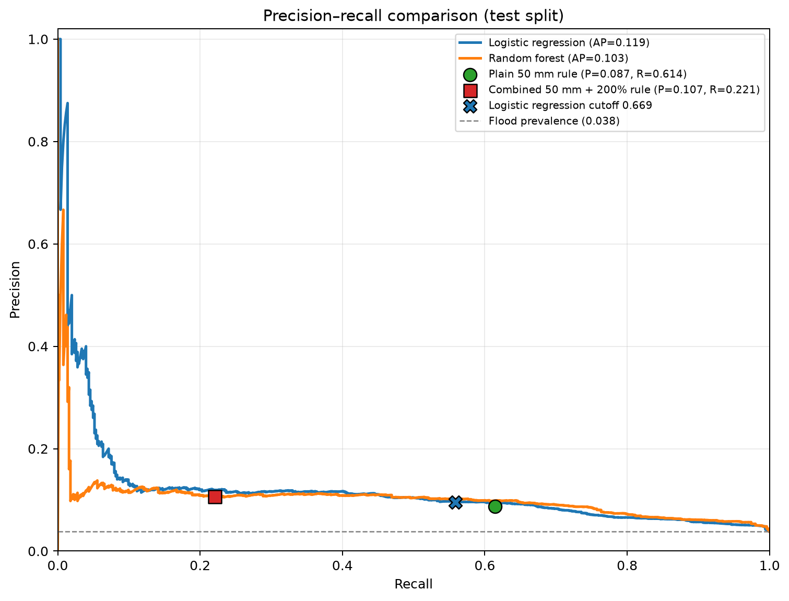

# Model comparison approach



Evaluate logistic regression, a random forest, and two rainfall baselines on the
same held-out test periods. Plot precision-recall curves for logistic
regression and random forest, with the two fixed rules shown as operating-point
dots. On this chart, farther right means more recall at the same precision.
The table reports precision, recall, F1, ROC-AUC, and confusion-matrix counts;
it excludes accuracy because floods are rare and an always-negative model
could appear accurate while missing every flood.

The logistic regression is reported at the default 0.5 probability cutoff and
at 0.669. The 0.669 cutoff was selected using training years only to achieve
the highest recall while keeping precision at least as high as the plain rule.
Random forest is shown at 0.5. The baselines are the plain rule (`rfh >= 50
mm`) and the combined rule (`rfh >= 50 mm` and `rfq >= 200`). Here `rfq` is
rainfall as a percentage of normal, calculated as
`(rfh + 5) / (rfh_avg + 5) * 100`; it is not a rainfall quantile.

Recall is the primary decision metric: a missed flood can strand a responder,
while a false alarm mainly causes a detour. Precision and F1 remain useful
supporting measures. ROC-AUC describes ranking over thresholds: for the plain
rule comparison it uses the continuous rainfall amount `rfh`, which allows the
rainfall signal to be compared with the continuous model scores. The combined
rule has a fixed binary score, so its ROC-AUC describes its single operating
point rather than ranking over multiple cutoffs.

Interpret results carefully: rainfall amount alone ranks risk nearly as well
as the learned models (ROC-AUC about 0.755 versus 0.757 for logistic
regression). The models offer a modest gain over the plain rule and a larger
gain over the stricter combined rule. Any claim about the size of that gain
should name which baseline and metric it refers to.

The script includes seeded fake data for checking the evaluation pipeline.
For real predictions, it joins `rfh` and `rfq` from `data/features.csv` by
`PCODE` and `date` when those fields are absent from the predictions file:

```powershell
python evaluation.py --demo
python evaluation.py --input data/predictions.csv --features data/features.csv --split test
```

The real-data command prints the comparison table and saves
`precision_recall_comparison.png`. Fake-data outputs are only harness checks;
they are not evidence about relative model performance.
